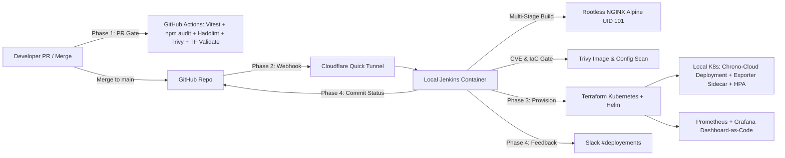

# The "Chrono-Cloud" E-Commerce DevSecOps Pipeline

An enterprise-grade, zero-cost (\$0) **Single-Tier DevSecOps CI/CD Pipeline** orchestrating a React luxury watch storefront (`Chrono-Cloud`) on a local Kubernetes cluster (`docker-desktop`) with shift-left security scanning, Terraform + Helm Infrastructure as Code, Prometheus/Grafana observability, and automated Slack + GitHub PR/commit feedback loops.

---

## Architecture Overview



---

## Implemented Portfolio Enhancements

1. **NGINX Prometheus Exporter Sidecar Pattern**
   - NGINX exposes `/stub_status` exclusively on localhost (`127.0.0.1:8080`), while the `nginx/nginx-prometheus-exporter:1.1.0` sidecar scrapes metrics and publishes Prometheus telemetry on port `9113`.
2. **Hardened Rootless Container & Kubernetes Security Context**
   - Multi-stage `Dockerfile` builds the React SPA in `node:20-alpine` and runs in `nginxinc/nginx-unprivileged:1.27-alpine-slim` as non-root **UID 101**.
   - Kubernetes Deployment enforces `allowPrivilegeEscalation: false`, `capabilities.drop = ["ALL"]`, `automountServiceAccountToken = false`, security headers, and `/healthz` liveness/readiness probes.
3. **Dual-Phase Shift-Left Security**
   - **Pre-Merge (GitHub Actions):** Runs Vitest UI tests, `npm audit --omit=dev`, Hadolint Dockerfile linting, Trivy container/IaC scanning, and `terraform fmt -check` + `terraform validate`.
   - **Post-Merge (Jenkins):** Enforces `trivy image --exit-code 1 --severity CRITICAL,HIGH` and `trivy config` before loading images into Kubernetes.
4. **Grafana Dashboard-as-Code**
   - Terraform provisions `chrono-cloud-grafana-dashboard` (`ConfigMap` labeled `grafana_dashboard=1`), auto-loading the **Chrono-Cloud Storefront Operations & NGINX Telemetry** dashboard into Grafana.
5. **Zero-Downtime Rolling Updates & HPA**
   - `RollingUpdate` (`maxUnavailable: 0`, `maxSurge: 1`) paired with `HorizontalPodAutoscaler` (`minReplicas: 2`, `maxReplicas: 5`, 75% CPU target).
6. **Memory-Tuned Monitoring Stack**
   - `kube-prometheus-stack` configured via Terraform Helm values to run smoothly alongside Jenkins on a 16 GB Windows workstation.

---

## Local Service Endpoints

| Service | URL | Credentials / Notes |
| :--- | :--- | :--- |
| **Chrono-Cloud Storefront** | `http://localhost:8088` | Rootless NGINX + React SPA (`/healthz` for probes) |
| **Jenkins CI/CD Server** | `http://localhost:8090` | Pipeline: `chrono-cloud-devsecops-pipeline` |
| **Grafana Dashboards** | `http://localhost:3005` | User: `admin` / Pass: `chrono-cloud-admin` |
| **Prometheus UI** | `http://localhost:9090` | Scrapes `chrono-cloud-nginx` targets on `:9113` |

---

## Quick Start & Operations

### 1. Configure Local Secrets (Never Commit!)
```powershell
Copy-Item .env.jenkins.example .env.jenkins.local
# Edit .env.jenkins.local with your GitHub PAT and Slack Webhook/Bot Token
```

### 2. Run Application Tests Locally
```powershell
npm install
npm test
npm run build
```

### 3. Start Local Jenkins & GitHub Webhook Relay
```powershell
docker compose -f docker-compose.jenkins.yml up -d --build
```
*(Starts Jenkins at `http://localhost:8090` plus the `chrono-cloud-webhook-relay` Smee.io sidecar forwarding GitHub push events directly to `/github-webhook/` inside Docker).*

### 4. Sync GitHub Webhook Automatically (One-Time Setup)
```powershell
powershell -ExecutionPolicy Bypass -File .\scripts\start-webhook-tunnel.ps1
```
*(Automatically configures **GitHub Repo → Settings → Webhooks** to forward `push` events through your `SMEE_URL` channel in `.env.jenkins.local` to local Jenkins).*

### 5. Manual Terraform Deployment (Optional)
```powershell
docker build -t chrono-cloud:local .
cmd /c "docker save chrono-cloud:local | docker exec -i desktop-control-plane ctr --namespace=k8s.io images import -"
terraform -chdir=terraform init
terraform -chdir=terraform apply -auto-approve -var="image_tag=local"
```
